# Compiler Pipeline & Architecture Guide

This document explains the four fundamental stages of this compiler project, detailing what each stage does, its input and output, and a breakdown of every function.

---

## Architecture Overview

```mermaid
flowchart LR
    Source["Source Code\n(Text String)"] --> Stage1["1. Lexer\n(lexer.java)"]
    Stage1 --> Tokens["Token Stream\n(List&lt;Token&gt;)"]
    Tokens --> Stage2["2. Parser\n(parser.java)"]
    Stage2 --> AST["AST\n(List&lt;Stmt&gt;)"]
    AST --> Stage3["3. Semantic Analyzer\n(SemanticAnalyzer.java)"]
    Stage3 --> ValidAST["Validated AST\n(List&lt;Stmt&gt;)"]
    ValidAST --> Stage4["4. Code Generator\n(CodeGenerator.java)"]
    Stage4 --> Target["Target Code\n(Java String)"]
```



---

## Phase 1: Lexical Analysis (`lexer.java`)

### What is a Lexer?
The **Lexer** (also called **Scanner** or **Tokenizer**) is the first phase of a compiler. It reads the source code as raw text (a sequence of characters) and groups them into meaningful language units called **Tokens** (such as numbers, variable names, keywords, and operators), while stripping away ignored characters like whitespace.

* **Stage Input:** `String source` (Raw source code text)
* **Stage Output:** `List<Token>` (An ordered list of token objects)

### Key Data Structures
* **`TokenType`**: An enum defining all recognized token kinds (`let`, `print`, `IF`, `Else`, `While`, `End`, `Var`, `Number`, `EQUALS`, `PLUS`, `MINUS`, `STAR`, `SLASH`, `NEWLINE`, `EOF`).
* **`Token`**: A class storing:
  * `type`: The `TokenType` category.
  * `text`: The raw text string matched in source.
  * `line` & `column`: Exact position in source code for diagnostics.

### Functions in `lexer.java`

| Function | Input | Output | Description |
|---|---|---|---|
| `current()` | None | `char` | Returns the character at the current position (`pos`), or `'\0'` if the end of source is reached. |
| `peek()` | None | `char` | Looks ahead at the next character (`pos + 1`) without consuming it or moving forward. |
| `advance()` | None | `void` | Advances the scanner by 1 character. Tracks newlines (`\n`) to update `line` count and reset `column` to 1. |
| `add(TokenType type, String text, int atLine, int atColumn)` | `type`, `text`, `atLine`, `atColumn` | `void` | Constructs a new `Token` object and appends it to the internal `tokens` list. |
| `error(String message, int atLine, int atColumn)` | `message`, `atLine`, `atColumn` | `void` (Throws `RuntimeException`) | Aborts lexical analysis with an error message containing exact line and column numbers. |
| `scan()` | None | `List<Token>` | The main loop. Iterates character-by-character, discards whitespace, identifies numbers, keywords, identifiers, symbols, appends an `EOF` token at the end, and returns all tokens. |

---

## Phase 2: Syntax Analysis (`parser.java`)

### What is a Parser?
The **Parser** is the second phase. It takes the linear sequence of tokens produced by the lexer and verifies whether they follow the grammatical rules of the language. If valid, it translates them into a hierarchical tree structure called an **Abstract Syntax Tree (AST)**. This project uses a **Recursive Descent Parser**.

* **Stage Input:** `List<lexer.Token>` (Tokens from Lexer)
* **Stage Output:** `List<Stmt>` (Abstract Syntax Tree representing the program statements)

### Key Data Structures (AST Nodes)
* **`ExprKind`**: Enum (`NUMBER`, `NAME`, `BINARY`).
* **`Expr`**: AST node representing expressions (literals, variable references, and binary operators with `left` and `right` sub-trees).
* **`StmtKind`**: Enum (`LET`, `ASSIGN`, `PRINT`, `IF`, `WHILE`).
* **`Stmt`**: AST node representing statements (variable declarations, assignments, print calls, conditionals, and loops).

### Functions in `parser.java`

| Function | Input | Output | Description |
|---|---|---|---|
| `current()` | None | `Token` | Returns the token at the current position `pos`. |
| `lookAhead()` | None | `Token` | Peeks at `tokens.get(pos + 1)` without advancing `pos`. |
| `match(TokenType type)` | `TokenType type` | `boolean` | Checks if `current().type == type`. If matched, consumes the token (`pos++`) and returns `true`; otherwise returns `false`. |
| `consume(TokenType type, String message)` | `TokenType type`, `String message` | `Token` | Confirms the current token matches the expected `type` and consumes it. If it doesn't match, throws a parse error. |
| `error(String message)` | `String message` | `void` (Throws `RuntimeException`) | Halts parsing with an error message showing the current line, column, and unexpected token found. |
| `parseProgram()` | None | `List<Stmt>` | The top-level entry point. Repeatedly skips newlines and parses statements until reaching `EOF`. |
| `parseStatement()` | None | `Stmt` | Inspects the current token to parse a specific statement: `let`, `print`, `if`, `while`, or an assignment. |
| `parseBlock(boolean stopAtElse)` | `boolean stopAtElse` | `List<Stmt>` | Parses a block of statements inside `if` or `while`. Stops when it encounters `end`, `EOF`, or `else` (if `stopAtElse` is true). |
| `parseCondition()` | None | `Expr` | Parses a conditional expression for `if` or `while` (e.g. `left = right`). |
| `parseExpression()` | None | `Expr` | Parses addition (`+`) and subtraction (`-`) with left-associativity. |
| `parseTerm()` | None | `Expr` | Parses multiplication (`*`) and division (`/`) with higher precedence than addition/subtraction. |
| `parseFactor()` | None | `Expr` | Base expression parser. Consumes a single number literal (`Number`) or variable name (`Var`). |

---

## Phase 3: Semantic Analysis (`SemanticAnalyzer.java`)

### What is a Semantic Analyzer?
The **Semantic Analyzer** checks for logical and semantic correctness that context-free grammar cannot enforce. In this language, it verifies that:
1. Every variable is **declared before use**.
2. No variable is **declared twice** (duplicate declarations are rejected).

* **Stage Input:** `List<Stmt>` (AST from Parser)
* **Stage Output:** `void` (Completes successfully or throws a semantic `RuntimeException`)

### Key State
* **`declared` (`Set<String>`)**: A Symbol Table (set) that tracks variable names currently declared in scope.

### Functions in `SemanticAnalyzer.java`

| Function | Input | Output | Description |
|---|---|---|---|
| `analyze(List<Stmt> program)` | `List<Stmt> program` | `void` | Clears the `declared` set, then starts checking all statements in source order from scratch. |
| `checkStatements(List<Stmt> statements)` | `List<Stmt> statements` | `void` | Iterates over each statement:<ul><li>**`LET`**: First validates the initialization expression via `checkExpr`, then verifies `s.name` is not already in `declared` (rejects duplicates), and adds `s.name` to `declared`.</li><li>**`ASSIGN`**: Ensures `s.name` exists in `declared` (declared before assignment), then checks `s.expr`.</li><li>**`PRINT`**: Verifies variables used in the print expression.</li><li>**`IF`**: Checks `condition`, then recursively checks statements in `body` and `elseBody`.</li><li>**`WHILE`**: Checks `condition`, then recursively checks statements in `body`.</li></ul> |
| `checkExpr(Expr expr)` | `Expr expr` | `void` | Inspects an expression recursively:<ul><li>**`NAME`**: Verifies that the variable name exists in `declared`; throws error if undeclared.</li><li>**`BINARY`**: Recursively calls `checkExpr(left)` and `checkExpr(right)`.</li><li>**`NUMBER`**: Numeric constants are always valid.</li></ul> |

---

## Phase 4: Code Generation (`CodeGenerator.java`)

### What is a Code Generator?
The **Code Generator** is the final phase of the compiler (the backend). It traverses the validated Abstract Syntax Tree and outputs target code. In this project, it translates MiniLang AST nodes into a complete, runnable **Java source code file**.

* **Stage Input:** `List<Stmt>` (Semantically checked AST)
* **Stage Output:** `String` (Valid, formatted Java source code)

### Functions in `CodeGenerator.java`

| Function | Input | Output | Description |
|---|---|---|---|
| `indent(int depth)` | `int depth` | `String` | Generates 4 spaces (`"    "`) per nesting depth level to format the generated Java code cleanly. |
| `expression(Expr expr)` | `Expr expr` | `String` | Recursively translates an expression tree to Java code text. Wraps binary operations in parentheses `(left op right)` to preserve evaluation precedence. |
| `statements(List<Stmt> list, StringBuilder out, int depth)` | `List<Stmt> list`, `StringBuilder out`, `int depth` | `void` | Emits Java code statements at the given indentation depth:<ul><li>**`LET`** $\rightarrow$ `int <name> = <expr>;`</li><li>**`ASSIGN`** $\rightarrow$ `<name> = <expr>;`</li><li>**`PRINT`** $\rightarrow$ `System.out.println(<expr>);`</li><li>**`IF`** $\rightarrow$ `if (<condition>) { <body> } else { <elseBody> }`</li><li>**`WHILE`** $\rightarrow$ `while (<condition>) { <body> }`</li></ul> |
| `generate(List<Stmt> program)` | `List<Stmt> program` | `String` | Main generation function. Wraps all emitted statements inside `class GeneratedProgram` and `public static void main(String[] args)`, returning the complete Java file as a string. |

---

## End-to-End Example

### Input Program (`MiniLang`)
```basic
let age = 20
let score = age + 10
print score
```

### 1. Lexer Output (Tokens)
```text
let(let)@1:1
Var(age)@1:5
EQUALS(=)@1:9
Number(20)@1:11
NEWLINE(\n)@1:13
let(let)@2:1
Var(score)@2:5
EQUALS(=)@2:11
Var(age)@2:13
PLUS(+)@2:17
Number(10)@2:19
NEWLINE(\n)@2:21
print(print)@3:1
Var(score)@3:7
NEWLINE(\n)@3:12
EOF()@4:1
```

### 2. Parser Output (AST)
```text
Stmt.let("age", Expr.number("20"))
Stmt.let("score", Expr.binary("+", Expr.name("age"), Expr.number("10")))
Stmt.print(Expr.name("score"))
```

### 3. Semantic Analyzer
* Checks `let age = 20`: Valid. `age` added to declared set.
* Checks `let score = age + 10`: `age` is declared. Valid. `score` added to declared set.
* Checks `print score`: `score` is declared. Valid.

### 4. Code Generator Output (`Java`)
```java
class GeneratedProgram {
    public static void main(String[] args) {
        int age = 20;
        int score = (age + 10);
        System.out.println(score);
    }
}
```
